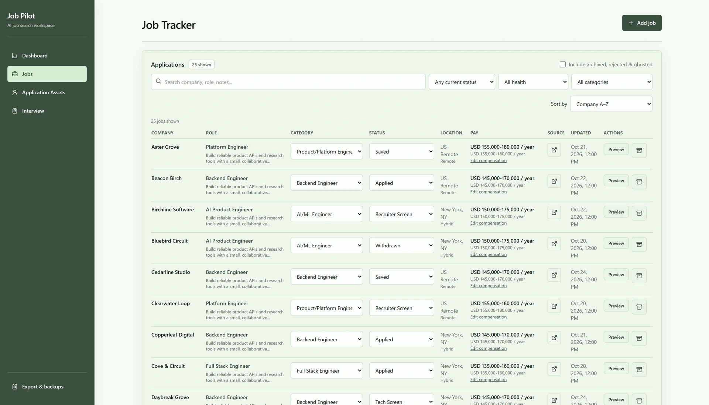
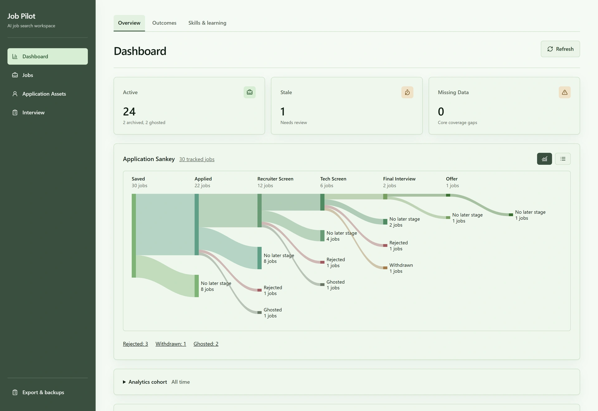

# JobPilot

A local-first workspace for managing a job search: track applications, tailor documents from reviewed evidence, compare outcomes, and practise interviews.

Built with **Next.js, React, TypeScript, FastAPI, SQLAlchemy and SQLite**.

## The workspace

| Destination | Features |
| --- | --- |
| **Dashboard** | Proportional application Sankey, scheduled actions, stale applications, compact Outcomes comparisons, project ideas and learning progress |
| **Jobs** | URL/text/manual intake, duplicate protection, filters, application history, job analysis, resume and cover letter workspaces |
| **Application Assets** | Reusable resumes, candidate profile, letter templates, versioned tailoring sources, coverage and ranking |
| **Interview** | Active practice, answer timers, feedback, previous sessions and attempt comparisons |

**Export & backups** provides CSV, full archives, validated restore and recovery copies. Views and filters use URLs, and supported drafts survive navigation and refresh.

Intake offers **Save**, **Apply**, **Tailor resume** and **Archive**. Apply records the Applied status locally. Tailor resume saves the job and opens preparation; generation remains an explicit action.

## Screenshots

The images below show the actual interface with **fictional demo data**. AI responses in the screenshots are authored examples, not live model evaluations.

### Jobs tracker

[](docs/assets/screenshots/01-jobs-tracker.png)

### Dashboard

[](docs/assets/screenshots/02-dashboard.png)

[More screenshots, captions and alt text](docs/assets/screenshots/README.md)

## Run locally

### Requirements

- Python **3.12 or 3.13**; the Windows examples use the Python 3.13 launcher.
- Node.js **22** and npm.
- An OpenAI key/model for AI actions; tracking and deterministic demo captures work without a live provider.
- Optional Tavily key for public company research.
- **TeX Live pdfLaTeX** for resume PDF rendering/export. Tracking and text workflows remain available without it.

### Install

From the repository root, in PowerShell:

```powershell
py -3.13 -m venv backend/.venv
.\backend\.venv\Scripts\python -m pip install -e "./backend[dev]"
npm --prefix frontend ci
Copy-Item .env.example .env
```

Set `OPENAI_API_KEY` and `OPENAI_MODEL` in `.env` when enabling AI. Keep `.env` local.

Start the backend in one terminal:

```powershell
cd backend
.\.venv\Scripts\python -m uvicorn app.main:app --reload --host 127.0.0.1 --port 8000
```

Start the frontend in another:

```powershell
cd frontend
npm run dev -- --hostname 127.0.0.1
```

Open **http://127.0.0.1:3000**. Backend health is available at **http://127.0.0.1:8000/health**. On macOS/Linux, use `python3 -m venv backend/.venv` and `backend/.venv/bin/python` for the equivalent commands.

The optional `pilot.ps1` helpers use `py -3.13` and require dependencies available to that interpreter. The separate-terminal commands above explicitly use the virtual environment.

### Configuration and storage

| Setting | Purpose |
| --- | --- |
| `DATABASE_URL` | Defaults to `backend/careerpilot.db`; relative SQLite paths are anchored to `backend/` |
| `OPENAI_API_KEY`, `OPENAI_MODEL` | Explicit AI operations |
| `TAILORING_CONTEXT_TOKENS` | Generation input budget |
| `TAVILY_API_KEY` | Optional company research |
| `NEXT_PUBLIC_API_BASE_URL` | Frontend backend URL, normally `http://localhost:8000` |
| `RESUME_PDFLATEX` | Optional path to the TeX Live executable; otherwise resolved from PATH |

Files default to `backend/storage/`. Migrations run at backend startup; `AUTO_MIGRATE=0` disables that behavior. The optional seed script resets its configured development database and is not needed for normal startup.

For PDFs, install the template packages `lmodern`, `microtype`, `enumitem`, `titlesec`, `geometry` and `hyperref`. Ubuntu setup:

```bash
sudo apt-get install texlive-latex-base texlive-latex-recommended texlive-latex-extra lmodern
```

### Review and privacy boundaries

JobPilot is intended for local use and does not provide multi-user authentication. Keep its API bound to localhost unless adding appropriate deployment controls. AI actions send the necessary job/profile/source content to configured providers; company research can use Tavily.

Reusable resume Ready status, source activation, saved-document content review and PDF layout approval are separate decisions. Source versions remain immutable. Profile edits and merges do not activate sources. Resume exports preserve exact saved revision/render bytes; reusable original-PDF downloads preserve the uploaded file. Cover letters export as TXT/Markdown.

Local databases, source documents, uploads, credentials, backups, logs and browser drafts are excluded from Git. Use fictional data for screenshots or issue reports. Public code does not make private application records public.

## Development checks

```powershell
# backend
cd backend
.\.venv\Scripts\python -m pytest -q -p no:cacheprovider

# frontend, from a separate terminal
cd frontend
npm run lint
npm run typecheck
node tests/list-editing.cjs
node tests/form-validation.cjs
npx playwright install chromium
npm run test:browser
npm run build
```

The browser suite starts isolated servers and synthetic data. PDF regressions require TeX Live. Run browser checks and builds sequentially. [Verification details](docs/verification.md) include scope and limitations. GitHub Actions is configured for backend tests, frontend checks/build and Chromium desktop/mobile workflows.

## Recreate the portfolio assets

After installing backend/frontend development dependencies:

```powershell
cd frontend
npx playwright install chromium
node node_modules/@playwright/test/cli.js test -c playwright.portfolio.config.ts
node scripts/package-portfolio.mjs
node scripts/verify-portfolio.mjs
```

This uses temporary demo storage, deterministic AI output and ports 3120/8120. It refuses to reuse existing servers and never opens the normal database. PNG originals, WebP website copies, a local gallery and captions live in [docs/assets/screenshots](docs/assets/screenshots/README.md).

## Documentation

- [Documentation index](docs/README.md)
- [Page architecture and compatibility contracts](docs/page-architecture.md)
- [Document workflow implementation references](docs/README.md#document-workflows)

Local mockups, execution notes and superseded recordings are intentionally excluded from the public source tree.
